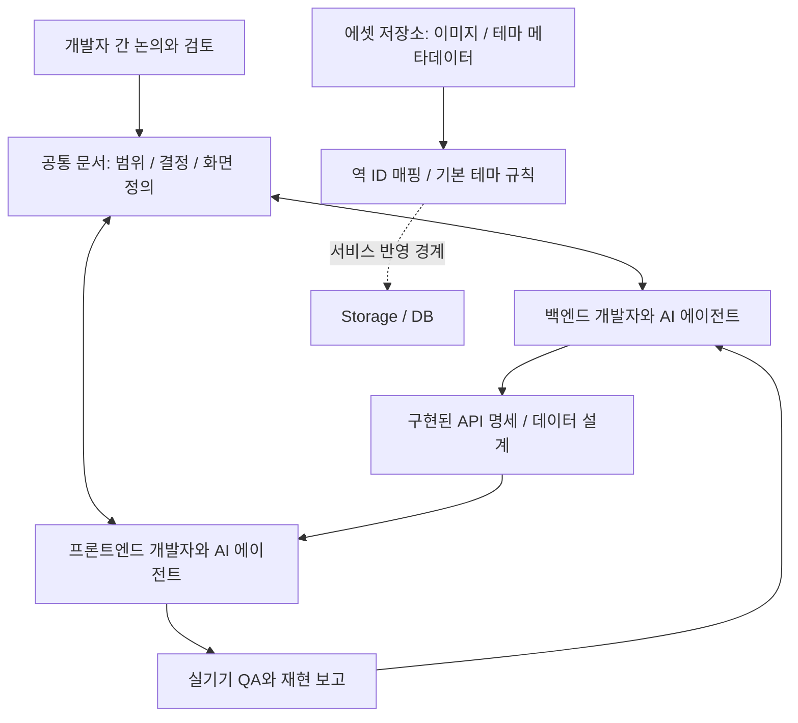
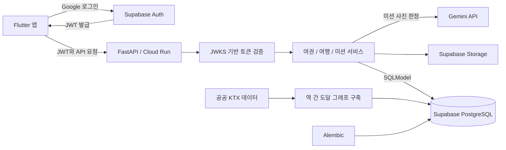

  

# 오늘출국

> 여권 컨셉의 국내 여행 기록 앱

여행을 떠나고, 미션을 수행하고, 나만의 여행 기록을 쌓는 앱입니다. 여권, 여행, 미션을 중심으로 국내 여행의 경험을 기록합니다.

이 저장소는 프로젝트 소개를 위한 공개 포트폴리오입니다. 서비스 소스 코드는 비공개로 관리합니다.

## 프로젝트 개요

| 항목 | 내용 |
| --- | --- |
| 개발 기간 | 2026.08 ~ 진행 중 |
| 담당 역할 | 백엔드 단독 담당 |
| 주요 기술 | Python, FastAPI, SQLModel, Alembic, Supabase, Google Cloud Run |

## 서비스 구성

- **여권과 여행 기록:** 여권 컨셉으로 여행과 미션을 연결합니다.
- **여행 미션:** 여행 중 수행할 미션과 기록 흐름을 제공합니다.
- **이동 데이터:** 공공데이터를 바탕으로 KTX 역 간 도달 관계를 구성합니다.

## 맡은 작업

백엔드 API와 데이터 구조를 설계하고 구현했습니다. FastAPI와 Supabase를 활용해 서비스의 백엔드를 구성하고 Google Cloud Run에 배포했습니다.

- API 약 **20개** 작성
- 테스트 **93개** 작성
- KTX **72개 역** 도달 그래프 구축

수치와 진행 상태는 2026.11.02 이력서 기준입니다.

## AI 에이전트를 활용한 협업

프론트엔드와 백엔드는 각자의 코드 저장소에서 개발하고, 공통 문서 저장소를 통해 제품 범위와 연동 기준을 맞췄습니다. 각 개발자의 AI 에이전트가 같은 문서를 읽고 갱신하도록 역할과 문서 관리 규칙을 정했습니다.

| 협업 영역 | 운영 방식 |
| --- | --- |
| 제품 범위 | 공통 MVP 문서에서 이번에 구현할 기능과 이후로 미룰 기능을 구분 |
| API와 화면 연동 | 구현된 API 명세와 화면별 연동 대상을 공유해 프론트엔드와 백엔드가 같은 계약을 참고 |
| 의사결정 | 미결정 질문과 상대 작업 요청을 별도 큐로 관리하고, 합의한 내용은 결정 기록으로 이동 |
| AI 작업 경계 | 프론트엔드와 백엔드 에이전트의 담당 문서를 나누고, 상대 영역 변경은 제안과 확인을 거쳐 반영 |
| 구현 상태 | 구현 전 설계와 실제 구현된 명세를 구분하고, 변경 후 로드맵과 화면 상태를 함께 갱신 |
| 불일치 처리 | 문서와 코드가 다르면 에이전트가 임의로 덮어쓰지 않고 차이와 근거를 제시해 사람이 판단 |

### 협업 중 해결한 문제

여행 취소 오류에 대해 백엔드가 1차 수정한 뒤에도 프론트엔드 실기기 QA에서 같은 문제가 재현됐습니다. 공유 문서에 재현 상황과 수정 결과를 남기고, 서버 로그를 확인해 알림 발송 이력의 외래 키 참조가 삭제를 막고 있음을 찾았습니다. 여행 삭제 전에 관련 알림 이력을 정리하도록 수정하고 원인과 조치 내용을 공유했습니다.

AI가 추정한 원인을 그대로 확정하지 않고, 실기기 재현과 서버 로그로 확인한 뒤 문서에 결과를 남겼습니다.

## 디자인 에셋도 협업 계약으로 관리

스탬프 테마 이미지는 코드와 분리한 에셋 저장소에서 버전 관리했습니다. 디자인 작업물이 백엔드 데이터와 연결될 수 있도록 파일명과 테마 메타데이터 규칙을 정했습니다.

- **식별자와 표시 이름 분리:** 이미지 파일명의 역 ID를 매핑 키로 사용하고 역 이름은 사람이 읽는 라벨로 사용합니다.
- **테마 메타데이터:** 표시 이름과 기본 테마 여부를 파일로 관리하고, 기본 테마는 하나만 지정하도록 규칙을 정했습니다.
- **이력 관리:** 같은 경로의 디자인을 교체하고 Git으로 변경 이력을 추적합니다.
- **서비스 반영 경계:** 에셋 원본과 서비스의 Storage 및 DB 반영 단계를 구분했습니다. 동기화 스크립트는 에셋 문서에서 작업 중으로 표시되어 있어 자동화 완료 성과로 제시하지 않습니다.

## 기술 선택

| 기술 | 사용 범위 |
| --- | --- |
| FastAPI | 백엔드 API |
| SQLModel / Alembic | 데이터 모델과 DB 마이그레이션 |
| Supabase | PostgreSQL, 인증, 파일 저장소 |
| Google Cloud Run | 백엔드 배포 |

## 백엔드 아키텍처

앱이 Supabase Auth에서 발급받은 토큰을 백엔드에 전달하면, FastAPI가 서명을 검증하고 회원 정보와 연결합니다. API와 서비스 계층을 나눠 여권, 여행, 미션의 처리 흐름을 구성했습니다. 데이터는 PostgreSQL에, 이미지는 Storage에 저장하며 미션 사진 판정은 Gemini API에 맡깁니다.

### 설계에서 신경 쓴 점

- **인증과 회원 처리 분리:** 토큰 검증과 회원 조회를 분리해 인증 구현이 비즈니스 로직에 섞이지 않도록 했습니다.
- **표준 PostgreSQL 사용:** SQLModel과 Alembic으로 데이터 모델과 변경 이력을 관리합니다.
- **이동 데이터 모델링:** 공공데이터를 역 간 도달 관계로 가공해 여행지 선택에 활용합니다.
- **테스트 DB 분리:** 운영 데이터와 분리한 PostgreSQL에 실제 마이그레이션을 적용해 검증합니다.

그림은 로컬 코드와 설계 문서에서 확인한 주요 구성만 담았습니다. 운영 주소와 비공개 저장소 링크는 포함하지 않습니다.

## 개발 상태

개발을 진행하고 있습니다. 공개 가능한 화면과 사용 흐름은 준비되는 대로 이 문서에 추가할 예정입니다.

## Developer

[장하늬](https://github.com/hany0147) / 백엔드
