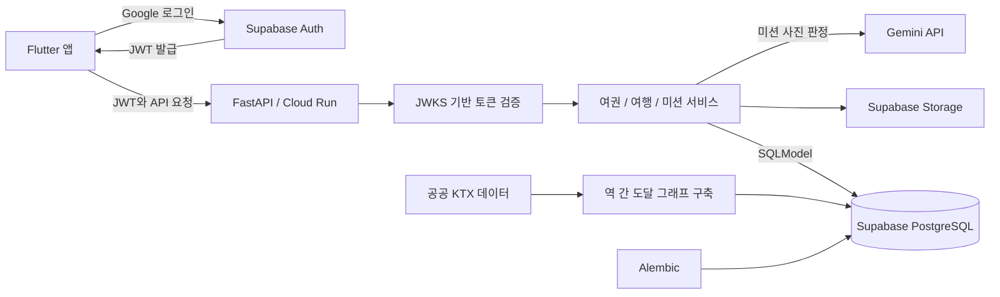

# 오늘출국

> 여권 컨셉의 국내 여행 기록 앱

여행을 떠나고, 미션을 수행하고, 나만의 여행 기록을 쌓는 앱입니다. 여권, 여행, 미션을 중심으로 국내 여행의 경험을 기록합니다.

이 저장소는 프로젝트 소개를 위한 공개 포트폴리오입니다. 서비스 소스 코드는 비공개로 관리합니다.

## 프로젝트 개요

| 항목 | 내용 |
| --- | --- |
| 개발 기간 | 2026.08 ~ 진행 중 |
| 담당 역할 | 백엔드 단독 담당 |
| 주요 기술 | Python, FastAPI, SQLModel, Alembic, Supabase, Google Cloud Run |

## 서비스 구성

- **여권과 여행 기록:** 여권 컨셉으로 여행과 미션을 연결합니다.
- **여행 미션:** 여행 중 수행할 미션과 기록 흐름을 제공합니다.
- **이동 데이터:** 공공데이터를 바탕으로 KTX 역 간 도달 관계를 구성합니다.

## 맡은 작업

백엔드 API와 데이터 구조를 설계하고 구현했습니다. FastAPI와 Supabase를 활용해 서비스의 백엔드를 구성하고 Google Cloud Run에 배포했습니다.

- API 약 **20개** 작성
- 테스트 **93개** 작성
- KTX **72개 역** 도달 그래프 구축

수치와 진행 상태는 2026.11.02 이력서 기준입니다.

## 기술 선택

| 기술 | 사용 범위 |
| --- | --- |
| FastAPI | 백엔드 API |
| SQLModel / Alembic | 데이터 모델과 DB 마이그레이션 |
| Supabase | PostgreSQL, 인증, 파일 저장소 |
| Google Cloud Run | 백엔드 배포 |

## 백엔드 아키텍처

앱이 Supabase Auth에서 발급받은 토큰을 백엔드에 전달하면, FastAPI가 서명을 검증하고 회원 정보와 연결합니다. API와 서비스 계층을 나눠 여권, 여행, 미션의 처리 흐름을 구성했습니다. 데이터는 PostgreSQL에, 이미지는 Storage에 저장하며 미션 사진 판정은 Gemini API에 맡깁니다.

### 설계에서 신경 쓴 점

- **인증과 회원 처리 분리:** 토큰 검증과 회원 조회를 분리해 인증 구현이 비즈니스 로직에 섞이지 않도록 했습니다.
- **표준 PostgreSQL 사용:** SQLModel과 Alembic으로 데이터 모델과 변경 이력을 관리합니다.
- **이동 데이터 모델링:** 공공데이터를 역 간 도달 관계로 가공해 여행지 선택에 활용합니다.
- **테스트 DB 분리:** 운영 데이터와 분리한 PostgreSQL에 실제 마이그레이션을 적용해 검증합니다.

그림은 로컬 코드와 설계 문서에서 확인한 주요 구성만 담았습니다. 운영 주소와 비공개 저장소 링크는 포함하지 않습니다.

## 개발 상태

개발을 진행하고 있습니다. 공개 가능한 화면과 사용 흐름은 준비되는 대로 이 문서에 추가할 예정입니다.

## Developer

[장하늬](https://github.com/hany0147) / 백엔드
